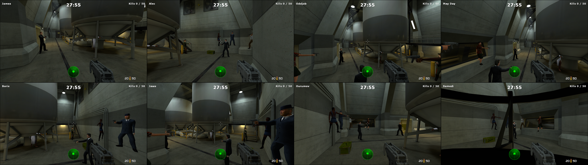
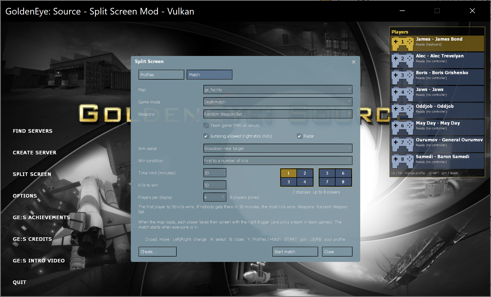
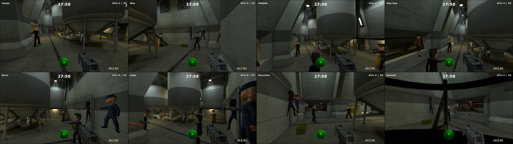
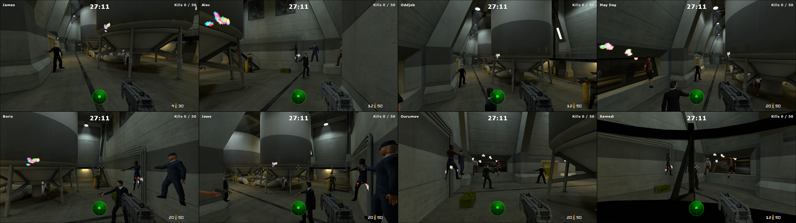

Local split screen for GoldenEye: Source: up to 8 players on one PC, each with their own controller, on one or two monitors.

## Install

1. Make sure you have **Steam**, **Source SDK Base 2013 Multiplayer** (free on Steam) and **GoldenEye: Source 5.0.6** installed.
2. Download **GES-SplitScreenMod-Setup-0.1.0.exe** below and run it.
3. Restart Steam and start **GoldenEye: Source - Split Screen Mod** from your library, or use the desktop shortcut.

The setup finds GoldenEye: Source through Steam, backs up every file it replaces, and adds an uninstaller (Windows Settings > Apps, or the Start menu) that puts the originals back. It uses the game's original renderer, and asks whether you'd prefer Vulkan instead.

Windows may show "Windows protected your PC" because the setup isn't code-signed: click **More info > Run anyway**.

## What's new

- **Split screen for up to 8 players**: whole screen, halves, 2x2, 3x2 and 4x2 layouts, and a second monitor for players 5 to 8.
- **SPLIT SCREEN** on the main menu, with player profiles (name, character, look speed) and a Match page (map, mode, weapons, teams, time and kill limits).
- **Controllers**: Xbox, PlayStation, Switch Pro and more. Players press START to join, and each player gets their own START menu with the leaderboard, team swap and exit.
- **Match options**: jumping, radar, aim assist (Classic GoldenEye, Sticky aim or Slowdown) and win conditions.
- **Cheats**: **Big Head** and **Paintball** (colourful paint instead of bullet holes and blood).
- GoldenEye's own health and armour dials, ammo, radar and scoreboard in every view.
- Menus that scale up for 1440p and 4K TVs.
- Runs on the engine's Vulkan renderer (`-vulkan`) as well as DirectX.
- Fixes: jump animations, lag compensation, explosion crashes, Shader Editor materials (Stack's glass, Bunker's screens) and more.

Full list and controls: [README](https://github.com/T3chnobone/ges-code-8PlayerSplitscreen/blob/ges-splitscreen/README.md) and [install guide](https://github.com/T3chnobone/ges-code-8PlayerSplitscreen/blob/ges-splitscreen/INSTALL_SPLITSCREEN.md).

## Screenshots

All captured in game on Vulkan.

**8 players joined on the Split Screen menu**

**Big Head cheat**

**Paintball cheat**

This is an unofficial fan build of GoldenEye: Source by Team GoldenEye: Source.
